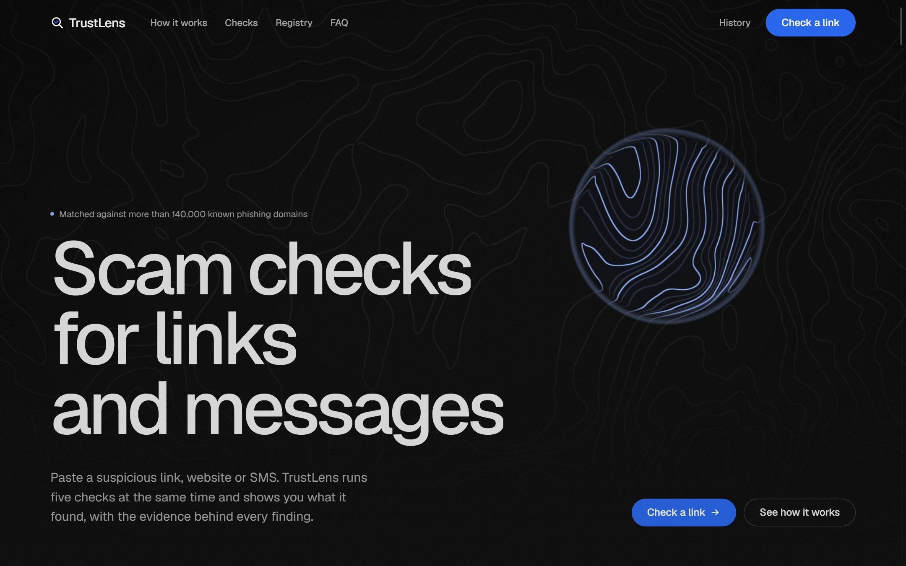
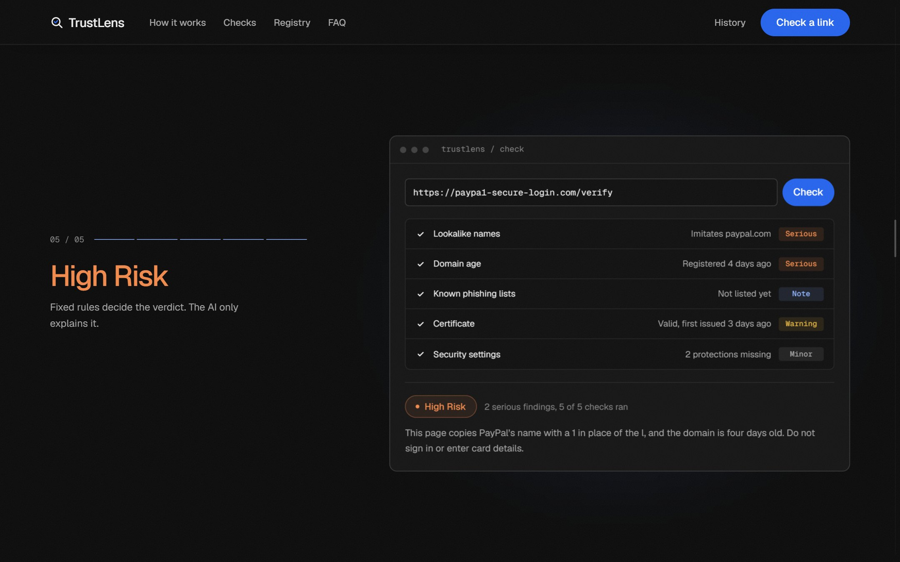
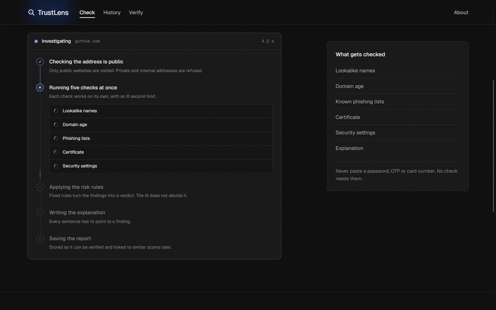
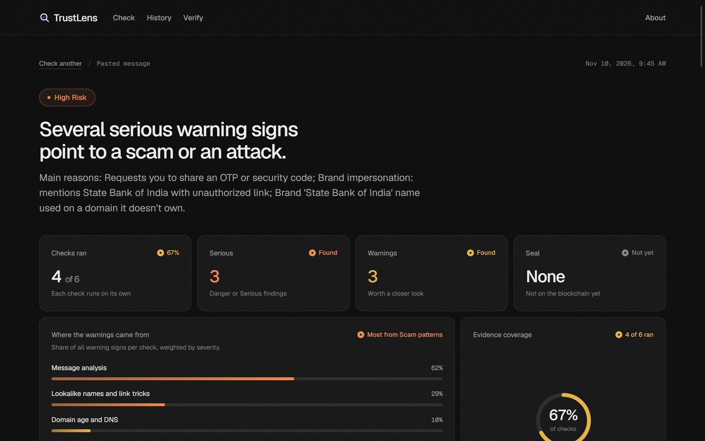
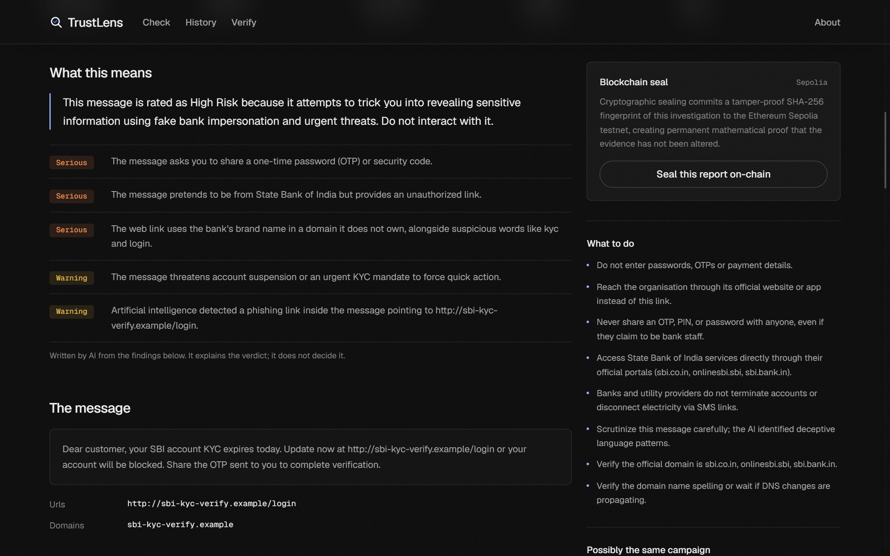
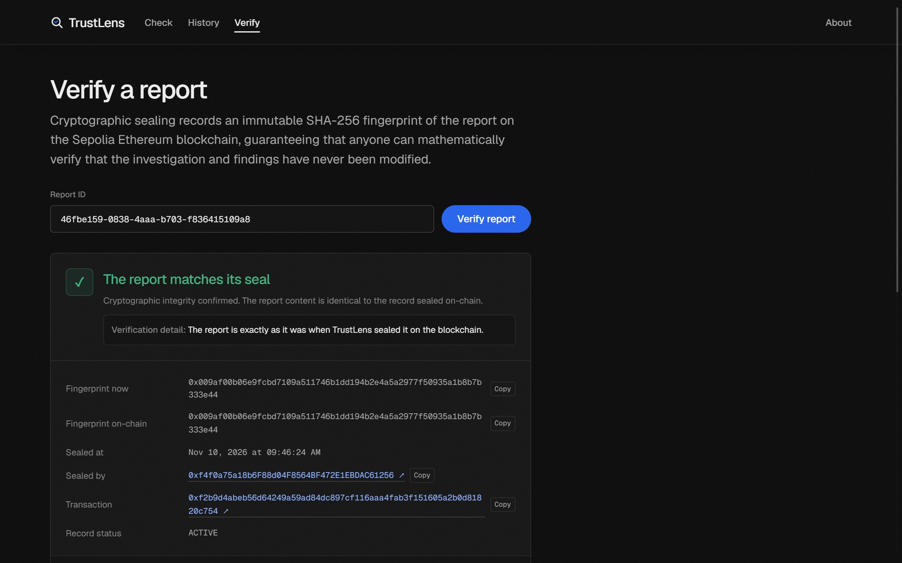
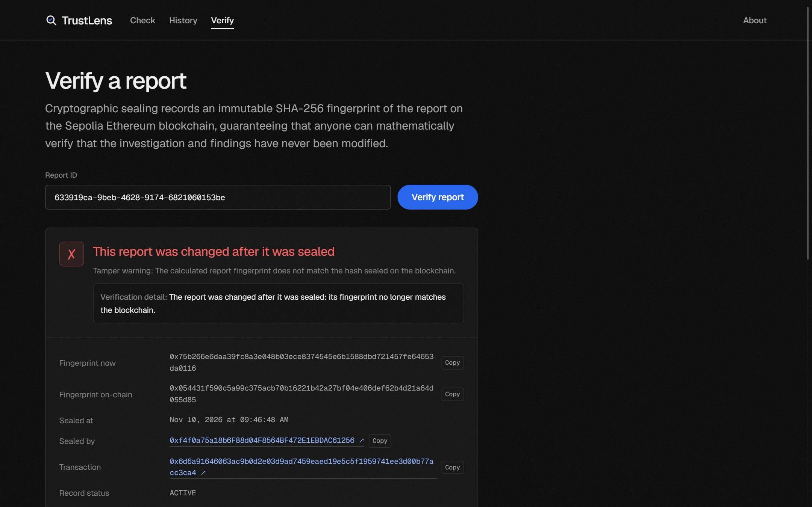
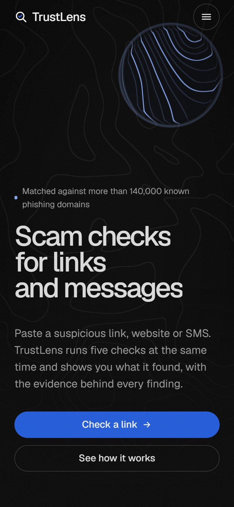
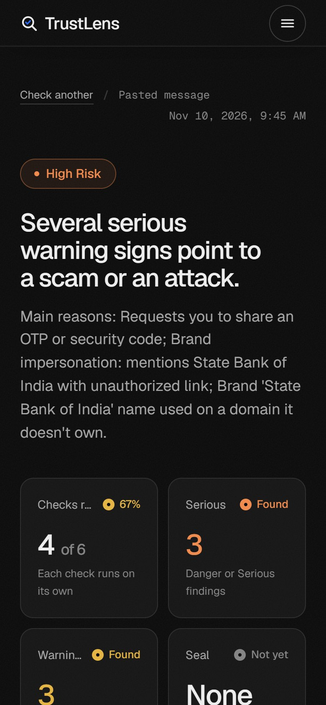
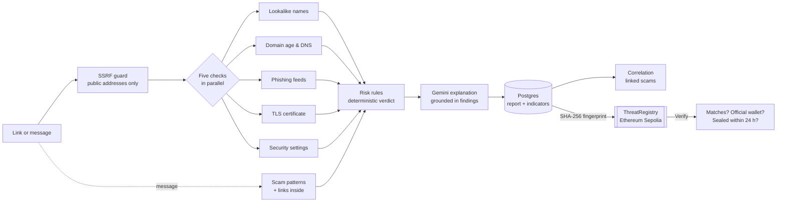

<div align="center">

# TrustLens

**Scam checks for links, websites and messages, with the evidence behind every verdict.**

Paste a suspicious link or SMS. TrustLens runs five security checks at the same time, gives a verdict from fixed
rules, explains it in plain English with AI, and can seal the report on Ethereum so anyone can prove later that it
was never changed.

[**Live site**](https://trustlens-check.vercel.app) · [API health](https://trustlens-api-p05f.onrender.com/api/health) · [Smart contract on Sepolia](https://sepolia.etherscan.io/address/0x089F4b08bcDBDEA5e3328D38676A63017266cb2e) · [Testing report](docs/testing-report.md) · [Demo script](docs/demo-script.md)

Built by **Team Breaking Bugs** for the **HackMatrix 2026** hackathon: *AI-Powered Web Threat Detection and Digital Trust Intelligence.*



</div>

## What it does

| | |
|---|---|
| **Check a link or website** | Lookalike names (paypa1, Cyrillic letters), domain age, five phishing and malware feeds, the TLS certificate (expired, revoked, self-signed, distrusted issuers) and the site's security settings. |
| **Check a message** | Pulls out every link, phone number, UPI ID and email, matches known scam patterns (fake KYC, OTP theft, job fees, lottery lures), and checks every link inside. |
| **A verdict you can trust** | Fixed rules decide between *Low Risk, Suspicious, High Risk, Confirmed Malicious* and *Inconclusive*. The AI never decides it and never calls a site "safe". |
| **Evidence, not a score** | Every finding says what was seen and where it came from. Coverage shows how much evidence could be gathered. |
| **Explanations in plain English** | Google Gemini writes the explanation from the findings only; each sentence must point to a finding, or it is removed. |
| **Linked scams** | Reports that share a server, certificate, phone number or UPI ID are shown together as a possible campaign. |
| **Tamper-proof reports** | The report's SHA-256 fingerprint is sealed on Ethereum Sepolia. Verify proves the report is unchanged, sealed by the official TrustLens wallet, and sealed in time. |

## Screenshots

| | |
|---|---|
|  **Landing page:** scrolling runs the five checks |  **Check page:** the live pipeline while a check runs |
|  **Report:** verdict, stat cards, where the warnings came from |  **Report:** AI explanation and the checks at a glance |
|  **Verify:** the report matches its seal on Sepolia |  **Verify:** an edited report is caught |

<p align="center">
  
  &nbsp;&nbsp;
  
</p>

## How it works



1. **Submit:** the address is normalised, and private, internal and cloud-metadata addresses are refused (SSRF protection).
2. **Investigate:** the checks run in parallel, each with its own time limit. All web requests go through one safe client: IP pinning, every redirect re-checked, 1 MB and 8 s limits, no JavaScript.
3. **Analyse and decide:** fixed rules turn the findings into a verdict. If fewer than half the checks could run, the verdict is *Inconclusive* rather than a guess.
4. **Explain:** Gemini rewrites the findings in plain English. Personal details are masked first, untrusted text is fenced off from instructions, and the reply is validated; if anything fails, a rule-based explanation is used.
5. **Seal and verify:** only the fingerprint, risk level and time go on-chain, never the link or the message.

More detail: [architecture](docs/architecture.md) · [security methodology](docs/security-methodology.md).

## Where the data is stored

| Place | What is stored |
|---|---|
| **Postgres database (Neon)**, for hosted deployments | Every report as JSON (`reports` table) and its indicators (domains, IPs, certificates, phones, UPI IDs, emails) for linking related scams (`indicators` table). Used whenever `DATABASE_URL` is set. |
| **SQLite file** `backend/data/app.db`, on your laptop | The same two tables, used automatically when `DATABASE_URL` is empty (local development, tests, the tamper demo). Git-ignored. |
| **Ethereum Sepolia** | Only each sealed report's SHA-256 fingerprint, risk level, time and the sealing wallet. |
| **Your browser** | Nothing except a flag so the intro animation plays once per visit. |

Render's free plan wipes the server's own disk whenever it sleeps, restarts or redeploys, which is why the live
backend supports a hosted Postgres database for reports. See [deployment](docs/deployment.md#2-backend-deployment-render).

## Team Breaking Bugs

| Member | GitHub | Area | Work |
|---|---|---|---|
| **Mohammed Asif Ali** | [@MdAsif678](https://github.com/MdAsif678) | Core platform | Analysis pipeline and risk engine, TLS certificate checks and SSRF protection, Gemini AI explanations, database design, website design and deployment. |
| **Md Azhar Khan** | [@azhar07kh-design](https://github.com/azhar07kh-design) | Security checks and scam messages | Lookalike detection, domain age, threat-intelligence feeds and security headers; scam-message analysis with scam-pattern rules, a sample dataset and AI classification. |
| **Md Adil Shamim** | [@adilsam-anon](https://github.com/adilsam-anon) | Blockchain | Smart contract deployment on Ethereum Sepolia, testnet wallet and network setup, blockchain seal and Verify pages with Etherscan links. |

## Tech stack

| Layer | Technology |
|---|---|
| Frontend | React 19, Vite, TypeScript, Tailwind CSS v4, Motion, Lenis, WebGL. Hosted on **Vercel** |
| Backend | Python 3.11, FastAPI, Pydantic v2, httpx, dnspython, cryptography. Hosted on **Render** |
| Database | Postgres (Neon) in production, SQLite locally |
| AI | Google Gemini (flash-lite, with automatic fallback models) |
| Threat intelligence | OpenPhish, Phishing Army, URLhaus, Google Safe Browsing, crt.sh / Cert Spotter, RDAP |
| Blockchain | Solidity 0.8.24, Hardhat 2, web3.py, Ethereum **Sepolia** |

**Deployed contract:** [`0x089F4b08bcDBDEA5e3328D38676A63017266cb2e`](https://sepolia.etherscan.io/address/0x089F4b08bcDBDEA5e3328D38676A63017266cb2e) on Sepolia ([deploy transaction](https://sepolia.etherscan.io/tx/0x36b9736b270e67485ed59a2db27d1970b710774a2fab8d06c2e8757c31451638)).

## Run it locally

You need Python 3.11+, Node.js 20+ and Git.

```bash
git clone https://github.com/MdAsif678/Hackmatrix_Breaking_Bugs.git
cd Hackmatrix_Breaking_Bugs
cp .env.example .env        # fill in the keys you have; every key is optional
```

**Backend** (terminal 1)

```bash
cd backend
python -m venv .venv
source .venv/bin/activate          # Windows: .venv\Scripts\activate
pip install -r requirements.txt
uvicorn app.main:app --reload      # http://localhost:8000, API docs at /docs
```

**Frontend** (terminal 2)

```bash
cd frontend
npm install
npm run dev                        # http://localhost:5173, /api is proxied to the backend
```

Without API keys the app still works: the missing sources are reported as "could not run" and the explanation is
written from the rules.

**Blockchain (optional).** For Sepolia, set `SEPOLIA_RPC_URL`, `REGISTRY_CONTRACT_ADDRESS` and `REGISTRY_PRIVATE_KEY`
(a throwaway testnet wallet) in `.env`. For a fully local chain:

```bash
cd contracts && npm install
npm run chain              # terminal 3, keep running
npm run deploy:local       # prints the contract address for .env
```

### Environment variables

| Variable | Purpose |
|---|---|
| `LLM_PROVIDER`, `LLM_API_KEY`, `LLM_MODEL` | Gemini for explanations and message analysis |
| `GOOGLE_SAFE_BROWSING_API_KEY`, `URLHAUS_AUTH_KEY` | Threat-intelligence lookups |
| `SEPOLIA_RPC_URL`, `REGISTRY_CONTRACT_ADDRESS`, `REGISTRY_PRIVATE_KEY` | Blockchain seal and verify (testnet wallet only) |
| `DATABASE_URL` | Postgres for production; empty = local SQLite |
| `CORS_ORIGINS` | The live frontend's address |
| `CHECK_TIMEOUT_SECONDS`, `REGISTRATION_WINDOW_HOURS`, `MOCK_ANALYZERS` | Tuning and demo options |

Secrets live only in `.env` (git-ignored) and the hosting dashboards.

### Tests

```bash
cd backend && python -m pytest -q        # 185 tests
cd contracts && npm test                 # 6 contract tests
cd frontend && npm run build && npm run lint
```

### Demo helpers

```bash
cd backend
python scripts/tamper_report.py <report-id>     # edit a sealed report so Verify shows "changed after it was sealed"
python scripts/fake_seal_attack.py <report-id>  # local Hardhat chain only: fake seal from another wallet -> "untrusted submitter"
python -m app.analyzers.tls_analyzer https://expired-rsa-dv.ssl.com   # run one check on its own
```

## Project structure

```
backend/      FastAPI app: pipeline, analyzers, risk engine, AI, correlation, storage, blockchain bridge, tests
frontend/     React app: landing, check, report, history and verify pages
contracts/    ThreatRegistry.sol, Hardhat tests and deploy script, Sepolia deployment record
docs/         architecture, security methodology, testing report, demo script, deployment guide, screenshots
```

## Limits worth knowing

- Automated checks cannot prove a website is safe. The best verdict is *Low Risk*: no warning signs in the checks that ran.
- A scam site set up an hour ago may not be on any list yet; the domain-age and lookalike checks are there for that case.
- A blockchain record proves a report has not changed since it was sealed, not that the report is correct.
- Free hosting: the backend may take about a minute to wake up if nobody has used it for a while.

## License

Built for the HackMatrix 2026 hackathon by Team Breaking Bugs.
